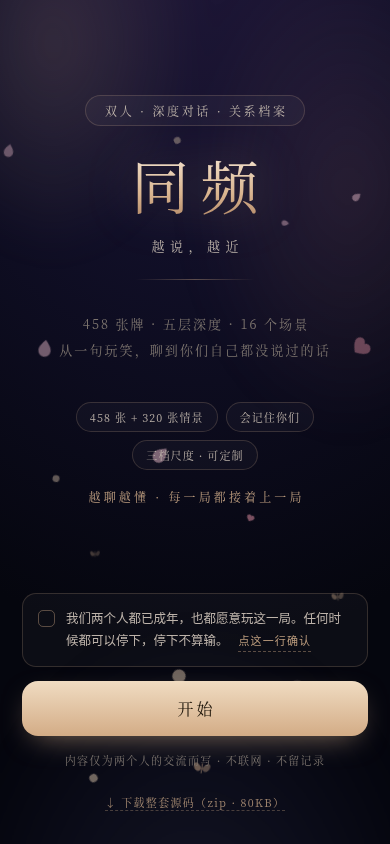
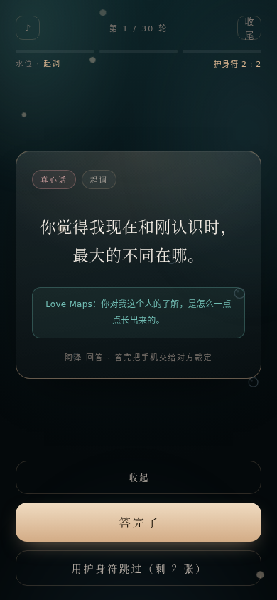
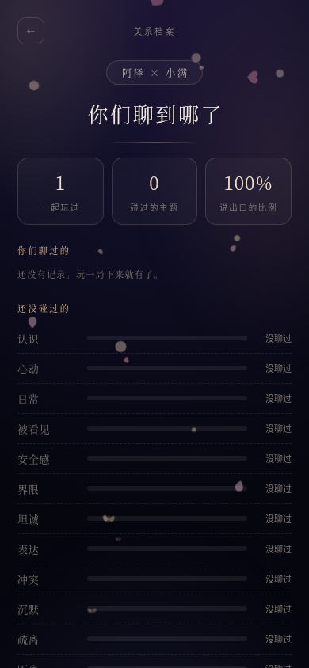

# 同频 · 越说越近

**双人深度对话卡牌 —— 458 张牌，五层递进，每一局都接着上一局。**

<p align="center">
  
  
  
</p>

> 不是「问题库」，是一条**逐层加深的对话路径**。每张深聊牌背后都有一句「为什么问这个」，点开才显示。
> 所有数据只存在你的浏览器里，不联网、不上传。


[](LICENSE)

---

## 这是什么

两个人（情侣、夫妻、或者想更了解彼此的人）轮流抽牌，回答，然后对方裁定"够不够诚"。
答得越实，层级越深。玩过几局之后，应用会生成一份**关系档案**——记住你们聊过什么、躲过什么、说过什么。

**它不是情趣用品。** 成人向内容（第 5 层「无间」）是**可选**的，需要双方各自确认才会打开，
而且只到"问出口"为止，不写动作描写。默认档位停在第 3 层。

## 快速开始

```bash
git clone <你的仓库地址> tongpin
cd tongpin
npm install     # 只有测试需要依赖，运行时零依赖
npm start       # → http://localhost:8000
```

也可以**直接双击 `index.html`** 打开（离线可用）。
唯一需要注意的是：部分浏览器在 `file://` 下会限制 localStorage，
如果想保存档案，建议用 `npm start` 起个本地服务。

### 部署

纯静态，任意平台都能放：

| 平台 | 做法 |
|---|---|
| **GitHub Pages** | Settings → Pages → Source 选 `main` / `root`，保存即可 |
| Vercel / Netlify | 导入仓库，不需要构建命令，输出目录填 `.` |
| 自己的服务器 | 把 `index.html`、`cards.js`、`custom-templates.js`、`icon.svg` 放到同一目录 |

> 三个 JS / HTML 文件必须在**同一层目录**，它们是相对路径引用的。

## 玩法

| 机制 | 说明 |
|---|---|
| **五层** | 起调 → 同频 → 共鸣 → 交心 → 无间。够诚 3 次升一层 |
| **真心话 / 大冒险** | 自己挑，不是随机甩给你 |
| **暗牌轮** | 每第 5 轮牌面朝下，摸到哪张算哪张 |
| **对方裁定** | 答完把手机交给对方，判「够诚」或「有点躲」。躲一次就浅一寸 |
| **护身符** | 每人 2 张，可以跳过一张。跳过不算输——这条是写进规则的退路 |
| **三档尺度** | 心动档（1–3 层）/ 深水档（+第 4 层）/ 成人档（+第 5 层，双方确认） |

### 关系档案：这套东西的核心

大多数情侣卡牌玩完就忘。这里不会——每答一张，会记下三件事：

1. **主题覆盖** — 你们碰过哪些，哪些一次都没聊过
2. **是否躲闪** — 哪一类题反复绕开（连续躲 2 次以上会单独标出）
3. **说过的原话** — 裁定前可以留一句对方刚说的话，存进档案

玩过的次数越多，档案越准。设置页的「从没聊过的地方开始」会把这些主题
**排到下次发牌的前面**，形成闭环：

```
玩 → 记录 → 下次针对性补 → 再记录
```

---

## 设计依据

这套牌的题目不是拍脑袋写的，四条线索：

| 依据 | 用在哪 |
|---|---|
| **Aron 逐层自我暴露** | 亲密的增长靠阶梯，一上来掏心会反弹。所以五层每层都有门槛 |
| **Reis 伴侣回应性** | 让人感到靠近的不是"被爱"，是**被准确理解**。所以大量题目在问"你当时真正的感受" |
| **Gottman 修复与情感地图** | 长期稳定不取决于吵不吵架，取决于修复速度和彼此的了解深度 |
| **Frankl 意义感** | 精神共鸣来自"为什么"，不是"怎么做"。共鸣牌专门补这一块 |

每张深聊牌带一句 `why` 字段，界面上点「为什么要问这个」才展开。
**知道机制比知道答案有用。**

## 内容构成

| 类别 | 数量 | 说明 |
|---|---|---|
| 常规牌 | 368 | 五层 + 8 个专题（破冰 / 暧昧期 / 热恋期 / 无话不说 / 无话可说 / 吵架后 / 异地 / 冷淡期） |
| 深聊牌 | 60 | 每层 12 张，带心理学依据 |
| 共鸣牌 | 30 | 每层 6 张，纯意义型问题 |
| 情景牌 | 320 | 16 个场景 × 五幕 × 4 张 |

**16 个场景**，每个都是"一出五幕的戏"（进 → 近 → 停 → 越界 → 之后）：

```
校园 / 医院 / 飞机 / 酒店 / 办公室 / 家里
枫树林 / 悬崖边 / 更衣室 / 无障碍厕所 / 酒吧
睡前 / 散步 / 车里 / 厨房 / 地铁
```

前 11 个是有情节的场景，后 5 个是**日常场景**——情侣真正待着的地方。

### 定制牌

设置页可以填入你们的暗号、常去的地方、上次说话是哪天、谁更常低头……
这些会被填进 **200 条模板**，生成只有你们答得上来的题。
填得越多，题越准。空着的项会自动跳过。

---

## 技术栈

**运行时零依赖**。没有框架、没有构建、没有 CDN。

```
index.html              应用本体（HTML + CSS + JS）
cards.js                牌库：常规 + 深聊 + 共鸣 + 场景
custom-templates.js     定制牌模板
icon.svg                图标
tests/run.js            回归测试（jsdom）
scripts/serve.js        本地预览服务器（零依赖）
```

- **无网络请求** — 打开后断网也能玩
- **无追踪** — 没有 analytics、没有第三方脚本
- **数据在本机** — localStorage，可随时一键清除
- **手机优先** — 为竖屏设计，宽度 390px 起

## 测试

```bash
npm test
```

覆盖：牌库完整性（无重复、字段齐全）、品牌与层级、关系档案跨局累积、
档案页渲染、依据展示、场景、定制牌、抽牌分布。共 8 组。

## 修改内容

所有台词都在两个数据文件里，改完刷新即生效，**不需要重新构建**：

- `cards.js` — 牌库。每张牌是 `{ theme, l, t, x, why? }`
  - `l` 层级 1–5，`t` 类型 `'t'` 真心话 / `'d'` 大冒险
  - `theme` 心理主题（关系档案按它统计）
  - `why` 可选，心理学依据，只有深聊/共鸣牌有
- `custom-templates.js` — 定制模板，`need` 声明需要哪些字段

加一张牌就是往数组里加一行，没有别的步骤。

## 隐私

这个项目的主张是：**亲密对话的数据不该离开两个人的设备。**

- 没有后端、没有账号、没有云同步
- 不收集任何使用数据
- 「关系档案」和「定制牌」都在 localStorage，设置页可一键清除

如果你 fork 之后加了后端，请务必在 README 里说明——不要破坏这条承诺。

## 许可

[MIT](LICENSE) — 可以商用、可以改、可以二次分发。

## 贡献

欢迎 PR。尤其是：

- 新的场景（最好是日常类的，比戏剧化的更稀缺）
- 心理学依据更准确的深聊题
- 英文翻译

提 PR 前请跑一遍 `npm test`。

---

**一句提醒**：这套东西的价值在第三、四局之后才显出来。第一局它只是张空白表。
如果第一局没聊出感觉，先别删——再玩两次，看看档案里那几个"反复绕开"的标记准不准。
